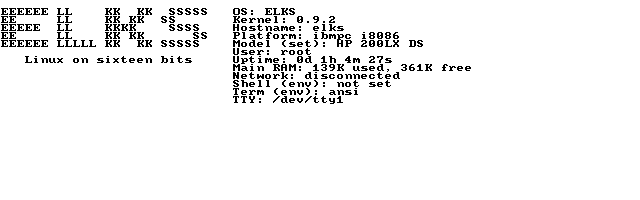
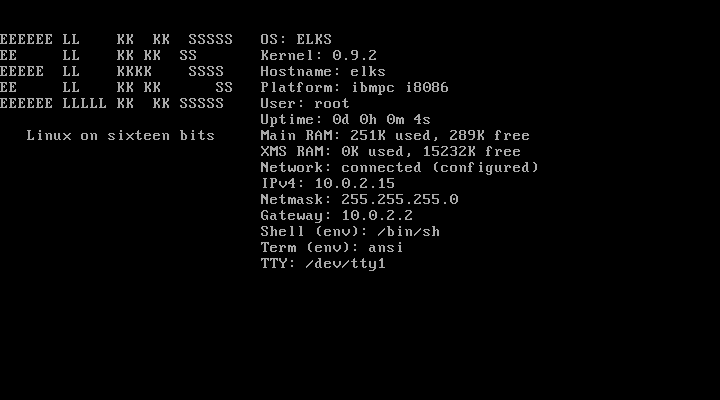
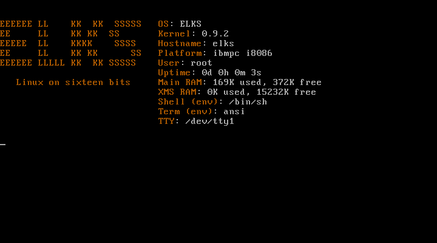
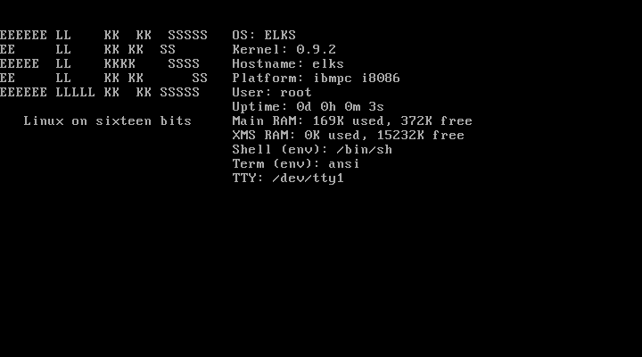
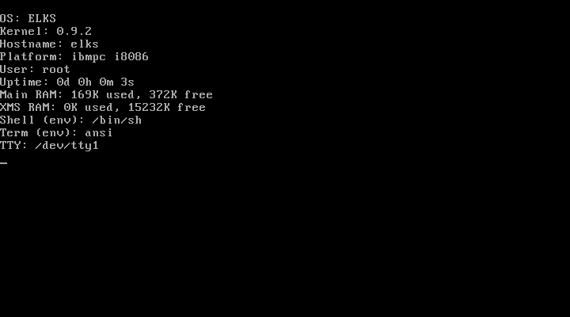

# ELKSfetch

A small native system-information utility for **ELKS on 8086-class computers**.
An ASCII ELKS wordmark, a handful of useful facts, and no Bash, Python or modern
Linux filesystem dependencies on the target.

Inspired by [Neofetch](https://github.com/dylanaraps/neofetch), written as a new
C program for [ELKS](https://github.com/ghaerr/elks). Intended hardware includes
the Amstrad PPC 512 and HP 200LX. Initial real-hardware tests now pass on an
HP 200LX DS; PPC 512 testing remains pending.

**Status:** private development, `0.1.0-dev`. Native IA16 cross-build and QEMU
runtime verified, plus an [HP 200LX DS hardware smoke test](docs/HP200LX-DS-20261101.md).
DOSfetch is planned, not implemented. The upstream integration
patch is a candidate and has not been submitted.



*Real HP 200LX DS running `hp200lx-4.0-cf`, captured with ELXcap 0.1 on
2026-11-01. Original [640×200 BMP](docs/screenshots/hp200lx-network.bmp) retained;
the PNG is a lossless viewing conversion. ELXcap reconstructs the logical text
page; LCD zoom, hardware inversion and cursor appearance are not reproduced.
The model label is explicitly configured, not auto-detected.*

## What it shows

- ELKS release, hostname and kernel platform string from `uname()`.
- Current user, uptime and memory usage through ELKS interfaces.
- Main and XMS memory pools, with used/free values in KiB (`K`). These are
  kernel-managed pools, **not total installed physical RAM**. Usage includes
  ELKSfetch itself. XMS is shown when the kernel reports a nonzero pool;
  this does not imply XMS-backed application allocation is enabled.
- Live network state and IPv4 address, plus netmask/gateway on newer `ktcp`.
- Shell and terminal environment values, explicitly labelled as such.
- TTY where available, and an optional machine label explicitly marked `set`.

Missing data remains unavailable; it is never replaced with a guessed CPU,
640K RAM, a hardcoded shell or an inferred machine model. No subprocesses or
external network probes are used to collect information. Networking uses a
read-only local socket query to `ktcp`.

## Usage

```sh
elksfetch
elksfetch --mono
elksfetch --plain
elksfetch --compact --width 40
elksfetch --host "Amstrad PPC 512"
elksfetch --host "HP 200LX"
elksfetch --logo wide --width 132
elksfetch --help
```

Colour is automatic only on a terminal with a nonempty, non-`dumb` `TERM`;
`NO_COLOR` disables automatic colour. Use `--color always`, `--color never`
or `--mono` to override it. Redirected output has no automatic escape codes.
`--plain` selects information-only, uncoloured output. Text is sanitized to
printable ASCII, clipped to the selected width and kept out of the final
column to avoid terminal wrapping. No cursor positioning is required.

The 26-column compact logo fits beside the fields on an 80-column display.
Narrow screens use a stacked layout. The original 100-column banner is
available with `--logo wide` on terminals wider than 100 columns; it falls back
to the small layout when it does not fit. The default width comes from the
terminal window size, with an 80-column fallback and `--width` override.

## Networking

With an active stack and an assigned address:

```text
Network: connected (configured)
IPv4: 10.0.2.15
Netmask: 255.255.255.0
Gateway: 10.0.2.2
```

With the stack stopped: `Network: disconnected`. A running stack with no IPv4
address shows `disconnected (no IPv4)`. Errors remain `unavailable` rather than
being mistaken for a disconnected network.

“Connected (configured)” means a live ELKS stack has an IPv4 address; it does
not certify Ethernet carrier, a SLIP peer, or Internet access. No ping, DNS
lookup or outgoing network connection is performed. Older stacks, including
the HP 200LX release 4.0 stack, can supply the IPv4 address through the socket
API but lack the newer mask/gateway query. The reply timeout then adds up to
about two seconds. Saved `/etc/net.cfg` values are not used as live status.
See [network implementation and validation](docs/NETWORKING.md).



*Actual ELKS console with QEMU NE2000 networking and a static guest address.*

## QEMU views



*Actual ELKS 0.9.2 console capture, 80 columns. QEMU is configured as a 486 PC;
the program is compiled for the 8086 instruction set. The `Platform` line is
ELKS's build/platform string, not a detected CPU model.*



*Actual QEMU console output with `--mono`.*



*Actual output with `--plain --width 40` on the same 80-column QEMU console;
this is not a photograph of a physical 40-column display.*

## Build with ELKS

With an already built ELKS checkout:

```sh
ELKSFETCH_ELKS=/path/to/elks sh toolchain/build-external.sh
```

The executable is `build/elksfetch`; copy it to `/bin/elksfetch` on ELKS.
On FAT, install through the image builder/mtools to preserve the long name;
for an in-guest copy, use the short filename `elkfetch`. All logos are embedded.
The build script uses the existing ELKS IA16 compiler,
libc and host tools, with no Python or checksum-tool prerequisite.

The included [integration patch](integration/elks-external.patch) follows
[ghaerr's external-repository guidance for ELKSWeb](https://github.com/ghaerr/elks/discussions/2185#discussioncomment-19053594):
`./buildext.sh elksfetch` clones/updates/builds the repository, and an
`ExtApplications` entry includes the binary in configured HD images. Default
floppy selections stay unchanged. Private clone access is required until the
repository is published.

See [building, remote compilation and image integration](docs/BUILDING.md)
and [validation evidence](docs/VALIDATION.md).

## Project layout

| Path | Purpose |
| --- | --- |
| `src/` | CLI, bounded formatting and ASCII layouts |
| `platform/` | ELKS system and network information collection |
| `toolchain/build-external.sh` | Minimal IA16 build for external application integration |
| `integration/` | Proposed upstream ELKS build/install patch |
| `artwork/` | Original wide wordmark and provenance |
| `tests/` | Host fixture checks and real ELKS/QEMU smoke test |
| `docs/screenshots/` | Genuine emulator captures for the README |

The collector is separate from the renderer so a future DOSfetch can share
the presentation code while using DOS/BIOS interfaces. See the [roadmap](docs/ROADMAP.md).

## Credits and licence

Created by Alexander Rau (`l00nix`). Thanks to ghaerr and the ELKS contributors
for the operating system, toolchain, system interfaces and external application
build approach. Neofetch inspired the presentation; no Neofetch source was
copied. New source code is [MIT licensed](LICENSE). See the
[artwork notes](artwork/README.md) for the supplied wordmark's provenance.
