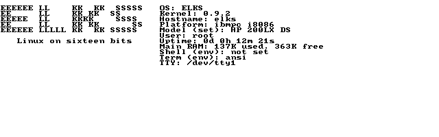

# HP 200LX DS hardware smoke test — 2026-11-01

**Passed on the physical HP 200LX identified by the owner as the DS machine.**
The existing ELKSfetch binary ran without a source change or rebuild. This is
an initial functional test, not a CPU-speed benchmark or full endurance test.



## System and installation

- Connection: the requested BH00K9NP adapter, serial at 9600 baud, 8N1.
- Kernel identity: `ELKS elks 0.9.2 hp200lx-4.0-cf 2026-10-21 ibmpc i8086`.
- Root filesystem: MINIX on `/dev/cfa1`.
- Test directory: `/root/fetch01`.
- ELKSfetch: `0.1.0-dev`, 9,712 bytes, the same binary tested in QEMU.
- ELXcap: existing version 0.1, 9,056 bytes, copied into that test directory
  because it was not installed on the command path.

The kernel, boot configuration and existing `/bin` tools were not replaced.
The initial long-command raw transfer handshake was interrupted by serial
line-editor echo/pacing; that incomplete test file was replaced using a
successful uuencoded transfer. Both final executables were verified with
`md5sum` on the HP before execution.

## Checks and results

| Check | Result |
| --- | --- |
| Transferred ELKSfetch matches local binary | Pass: MD5 `76d81cf043398a783c411ccebd40002f` |
| Version | `elksfetch 0.1.0-dev` |
| Plain output over serial | Pass; no colour escapes |
| Kernel identity and hostname | ELKS 0.9.2, hostname `elks` |
| Current user and TTY | `root`, `/dev/ttyS0` |
| Uptime | 11m33s, later 14m1s; native `uptime` reported 11 and 14 minutes |
| Main-memory accounting | 115K used / 385K free during direct serial execution |
| Environment handling | `TERM=ansi`; `SHELL` absent and honestly reported `not set` |
| Invalid width | `--width 0` rejected with status 2 |
| Monochrome output on HP console | Pass, using `/dev/tty1` |
| Configured model label | `Model (set): HP 200LX DS` |
| ELXcap capture | Pass, exit status 0, original 640×200 one-bit BMP |
| Download integrity | HP and local BMP MD5 both `143f673f8cf9d119358052764f907b94` |

The screenshot reports 137K used / 363K free because the capture script adds
another shell while ELKSfetch runs. Both readings total the kernel-reported
500K main-memory pool. They do not represent installed physical RAM, and
ELKSfetch's own memory contributes to the used figure. The `Platform` value
is the kernel's build string; the DS model label is configured from the
owner's identification, not detected by the application.

## Reproduce on this HP

The test utilities and capture remain in `/root/fetch01`:

```sh
cd /root/fetch01
./elksfetch --plain
./elksfetch --mono --host "HP 200LX DS"
```

For a fresh HP-console capture from the serial shell, use a new output filename
(ELXcap refuses to overwrite an existing image):

```sh
clear > /dev/tty1
./elksfetch --mono --host "HP 200LX DS" \
  < /dev/tty1 > /dev/tty1
./elxcap -q hpnext.bmp
```

At 9600 baud, keep interactive command lines short; a small script is useful
for longer commands. The saved `show` script generated the existing
`hpmono.bmp`; rerunning it without changing the filename will be refused at
the capture step. A final `sync` completed after testing.

## Screenshot provenance and scope

The [original BMP](screenshots/hp200lx-ds.bmp) was generated by ELXcap on this
physical HP, downloaded over serial and checksum-verified. The PNG is a
lossless viewing conversion, without content edits. ELXcap reconstructs text
mode from the active logical 80×25 page and fonts; it does not reproduce LCD
zoom/pan, cursor or global hardware inversion. This is not a photograph of
the LCD and is not an emulator or fixture image.

[Machine-readable manifest and SHA-256 hashes](HP200LX-DS-20261101.json).
The complete serial transcript, including transfer framing, is retained
locally under `test-output/hp200lx-ds/serial.log` rather than embedded in the
README. PPC 512 testing and broader HP endurance/terminal coverage remain
pending. DOSfetch remains unimplemented.
