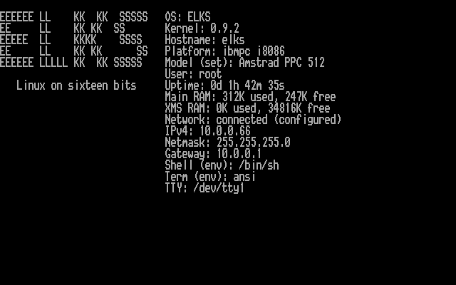
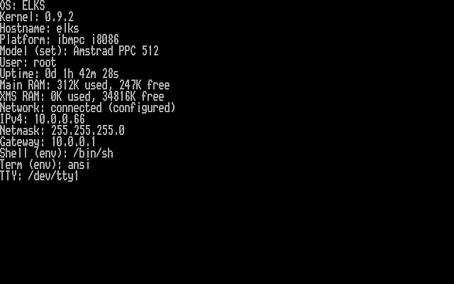

# Amstrad PPC 512 hardware smoke test — 2026-11-01

The exact ELKSfetch 0.1 draft-release executable ran successfully on the
physical Amstrad PPC 512 with PicoMEM. This was a hardware smoke test, not an
emulator run or an endurance/performance benchmark.

## Executable and environment

- Executable: 10,928 bytes; version output `elksfetch 0.1`.
- SHA-256: `3212efc6c532e02e16368e18d369228519388a22bc36ed2bbeaa0134fd7f7054`.
- Device MD5: `7192d431ab7bd17389438a96a047fcf5`, matching the local release binary.
- Upload followed by full FTP readback was byte-identical.
- Test installation: `/root/ef1101/elksfetch` on the PPC's MINIX root filesystem.
- Existing networking: IPv4 `10.0.0.66`, mask `255.255.255.0`, gateway `10.0.0.1`.
- Commands/transfers used the existing telnet/FTP connection. Existing serial
  bridge processes were left alone; no networking or boot configuration changed.

Live `uname -a`:

```text
ELKS elks 0.9.2 commit e7a56a43 01 Nov 2026 15:42:06 +0000 ibmpc i8086
```

## Results

| Check | Result |
| --- | --- |
| Release executable integrity and `--version` | Passed |
| `--plain` output and successful exit | Passed |
| Kernel identity, user, uptime, memory and terminal fields | Present |
| Uptime compared with `ps -u` | Both reported 1 hour, 41 minutes during the initial run |
| Live networking | Connected/configured; IPv4, mask and gateway reported |
| `--mono --host "Amstrad PPC 512"` on `/dev/tty1` | Passed; captured |
| `--plain --width 40 --host "Amstrad PPC 512"` on `/dev/tty1` | Passed; captured |
| Full 16-row layout, including model/XMS/network/TTY | Displayed without losing final fields |
| Final `sync` | Passed |

The initial telnet run reported 290K used / 269K free in the main memory pool.
The screenshots report 312K used / 247K free because the capture runs through
an additional shell. Both show an XMS pool of 34,816K free. These are ELKS
kernel pool statistics, not a claim about the PPC's factory-installed RAM or
whether XMS-backed application allocation is enabled. The model label is
explicitly configured; `Platform` remains the kernel's build string.

## Display captures





The program drew directly to the PPC console, with stdin and stdout connected
to `/dev/tty1`. After each run, `dd` read the 4,000 character/attribute bytes
from physical B8000h through `/dev/kmem`:

```sh
cd /root/ef1101
cat clear > /dev/tty1
./elksfetch --mono --host "Amstrad PPC 512" < /dev/tty1 > /dev/tty1
dd if=/dev/kmem of=mono.bin bs=16 skip=47104 count=250
```

`clear` contains only the ANSI clear-screen/home sequence. The compact capture
used the same procedure with `--plain --width 40`. BIOS data-area bytes confirmed
mode 3, 80 columns and active page 0. The first 128 8×8 glyphs were freshly read
from the PPC ROM at FFA6Eh. The existing PPC text renderer combined the raw cells
and font, applying the CGA palette and doubling each scan line to 640×400.

These images are reconstructed logical text displays, not photographs of the
LCD. Its tint/contrast and cursor/blink phase are not reproduced. The compact
view limits program output to 40 columns; the hardware remains in 80-column
mode. No text was drawn over the capture or synthesized from the transcript.

The [capture manifest](PPC512-20261101.json) records image, video-memory and
font hashes. The [session transcript](screenshots/ppc512-session.txt) records
commands, native output and return statuses. Companion `ppc512-mono.txt` and
`ppc512-compact.txt` files decode the captured character cells.

The executable, two capture scripts, clear sequence and raw captures remain
in `/root/ef1101`. The monochrome view was left on the PPC display. System
binaries and ongoing USB-test files were not changed.

## Scope

This verifies the release binary on the PPC's current ELKS/PicoMEM setup with
networking already active. It does not test stopping networking, an active
older-stack fallback, every terminal mode, or long-term stability. Broader
PPC/HP acceptance remains future work. The v0.1 executable and source tag
were not changed to add this later hardware evidence.
